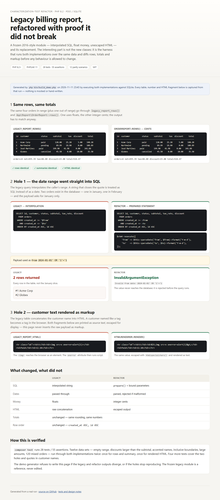

# Legacy PHP refactor, with proof it did not break

A frozen "2016-style" billing report — string-interpolated SQL, float money, unescaped HTML — and its refactor. The point of the repo is not the new classes: it is the **parity harness** that runs both implementations over the same data and diffs rows, totals and markup.

```bash
composer install
composer test        # 28 tests, 55 assertions
composer demo        # legible before/after in the terminal
composer demo:docs   # regenerate docs/index.html from a real run
```

**[Live demo](https://bluefang05.github.io/php-legacy-refactor/)** — the same data through both implementations, the two holes, and the tests behind it.

[](https://bluefang05.github.io/php-legacy-refactor/)

## The problem

The original module is a classic maintenance situation: one function queries orders, computes totals with floats, and prints an HTML table by concatenating strings. It works for the numbers the business already trusts, and it has two holes nobody has touched:

1. **The date range is interpolated into the SQL string.** `2024-01-01' OR '1'='1` returns every row.
2. **Customer text is printed as HTML.** A customer named `` becomes markup.

Rewriting it blindly is how finance ends up with cent-level discrepancies. So the order was: freeze behaviour first, then change internals.

## The approach

1. **Characterization tests.** `tests/ParityTest.php` runs 12 scenarios (empty range, discounts larger than the subtotal, accented names, inclusive date boundaries, large amounts, repeated pennies, 120 mixed orders…) through the legacy functions and the new classes and asserts identical rows, identical summaries and identical HTML.
2. **Refactor behind the tests.** `App\Report\OrderReport` uses prepared statements and a validated date; `OrderRow` holds money as integer cents; `HtmlRenderer` escapes customer text.
3. **One test per hole.** `tests/SecurityTest.php` documents that the legacy implementation is still injectable/unescaped, and asserts the new one is not.

```
src/Legacy/legacy_report.php   frozen reference, untouched
src/Report/OrderReport.php     prepared statements + date validation
src/Report/OrderRow.php        integer cents
src/Report/HtmlRenderer.php    htmlspecialchars
tests/ParityTest.php           12 scenarios × rows/summary/HTML
tests/SecurityTest.php         injection, XSS, malformed dates, quotes
```

## What changed and what did not

| | Legacy | Refactor |
| --- | --- | --- |
| SQL | interpolated | `prepare()` + bound parameters |
| Dates | passed through | parsed and rejected if malformed |
| Money | floats | integer cents |
| HTML | raw concatenation | escaped output |
| Totals | unchanged | unchanged |
| Row order | unchanged | unchanged |

The `demo` command prints the same five rows twice (legacy and refactor), the matching summaries, and then the two holes side by side:

```
legacy:        raw  tag reached the browser
refactor:      escaped with htmlspecialchars

legacy rows:   6 (every row leaked)
refactor:      InvalidArgumentException: Invalid from date: 2024-01-01' OR '1'='1
```

The published page is generated, not written: `bin/build_demo.php` runs both implementations against SQLite, captures their outputs, and refuses to write the HTML if the rows diverge or the holes stop reproducing. The raw XSS payload is printed as escaped source text, never inserted as markup.

## Stack

PHP 8.2+ · PDO · SQLite for tests (MySQL is a connection change) · PHPUnit 11 · GitHub Actions matrix on PHP 8.2 and 8.3.

## How this was built

AI-assisted workflow with the test suite as the acceptance gate: the parity tests were written first, and no refactor step was accepted while they were red.
